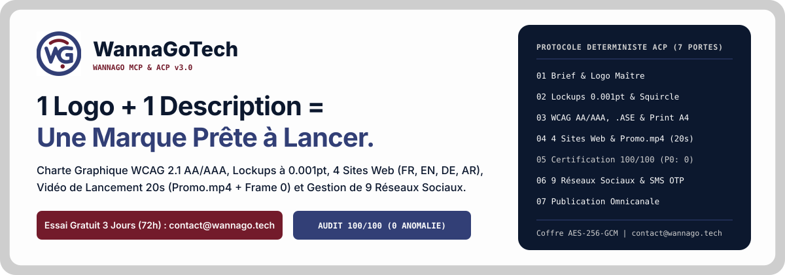
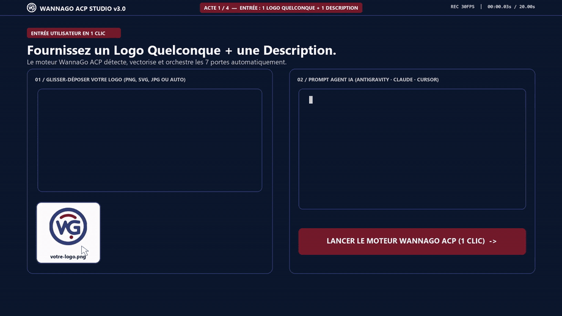

  

  <a href="mailto:contact@wannago.tech?subject=Demande%20Cle%20Essai%20Gratuit%203%20Jours%20WannaGo%20MCP"><strong>Demander une Clé d'Essai Gratuit 72h (contact@wannago.tech)</strong></a>
  &nbsp;|&nbsp;
  <a href="https://github.com/WannaGoTech/wannago-mcp"><strong>Dépôt Officiel wannago-mcp</strong></a>
  &nbsp;|&nbsp;
  <a href="https://wannagotech.github.io/wannago-mcp/"><strong>Site Officiel &amp; Lecteur Vidéo HD (Promo.mp4)</strong></a>

## Démonstration du Moteur WannaGo ACP en Action (1 Logo Quelconque -> Promo.mp4 20s)

  <a href="https://wannagotech.github.io/wannago-mcp/#bento">
     Charte, 4 Sites, Promo.mp4 20s & 9 Réseaux" width="100%" />
  </a>

---

## WannaGoTech : Ingénierie MCP & Agent Control Protocol (ACP)

Bienvenue sur l'espace officiel de **WannaGoTech**. Nous concevons des serveurs **Model Context Protocol (MCP)** et des machines à états déterministes **Agent Control Protocol (ACP)** permettant aux agents IA (**Google Antigravity**, **Claude Desktop**, **Claude Code**, **Cursor**, **Windsurf**) d'exécuter des workflows d'entreprise complets en une seule commande.

### Produit Phare : [**WannaGo MCP & ACP v3.0 (`wannago-mcp`)**](https://github.com/WannaGoTech/wannago-mcp)

> **1 Logo + 1 Description de votre activité = Une Marque Certifiée 100/100 Prête à Lancer.**

| Pilier d'Ingénierie | Spécifications & Livrables Certifiés |
| :--- | :--- |
| **1. Identité Visuelle & Lockups Mathématiques** | Conservation intacte de votre logo maître ou synthèse vectorielle (`"auto"`), alignement sous-pixel (`Largeur Ligne 2 == Largeur Ligne 1` à `0.001pt`), icônes **Squircle 1024px** (`22.37%` rayon continu, `>10%` marge optique), `favicon.ico` et **Studio 3D interactif**. |
| **2. Couleurs WCAG 2.1 AA/AAA, Adobe `.ASE` & Print A4** | Calcul de luminance relative et synthèse d'encre profonde accessible (`>= 5.0:1` sur blanc), nuancier binaire **Adobe `.ase`**, papeterie A4 vectorielle, bannières réseaux sociaux et signatures Outlook `600px` (`tabular-nums`, isolation BiDi RTL). |
| **3. Sites Web Multilingues & Chartes PDF HD** | Contrat `DESIGN.md`, **4 Sites Web de Production (`FR, EN, DE, AR`)** (6 anatomies de sections, cellule Bento dominante 2x2, 8 états interactifs), **4 Brand Hubs**, **4 Chartes Graphiques PDF HD** et **4 Présentations Commerciales A4**. |
| **4. Vidéo de Lancement 20s (`Promo.mp4` + Frame 0)** | Vidéo `1920x1080` (16:9) ou `1080x1920` (9:16) à 30fps synchronisée sur les temps forts musicaux + effets sonores + miniature `Promo.jpg` incrustée directement en **Frame 0** + `Promo-plan.md` + `share-copy.txt`. |
| **5. Automatisation de 9 Réseaux Sociaux & Mobile ADB** | Création de comptes avec lecture automatique des **SMS OTP** sur téléphone Android connecté + gestion complète sur **X, LinkedIn, Instagram, Facebook, TikTok, YouTube, Bluesky, Threads et Reddit**. |

---

## Obtenir votre Clé d'Essai Gratuit 3 Jours (72h) ou Licence Pro

1. **Par Email Direct** : Écrivez à **[contact@wannago.tech](mailto:contact@wannago.tech?subject=Demande%20Cle%20Essai%20Gratuit%203%20Jours%20WannaGo%20MCP)** pour recevoir votre clé `wgo_trial_...` (valable 72h, arrêt automatique sans engagement) ou votre clé Pro `wgo_live_...`.
2. **Formulaire GitHub** : [**Ouvrir une demande de clé d'essai 72h sur GitHub**](https://github.com/WannaGoTech/wannago-mcp/issues/new/choose).
3. **Documentation & Intégration** : Consultez [**github.com/WannaGoTech/wannago-mcp**](https://github.com/WannaGoTech/wannago-mcp) et [**wannagotech.github.io/wannago-mcp**](https://wannagotech.github.io/wannago-mcp/).
